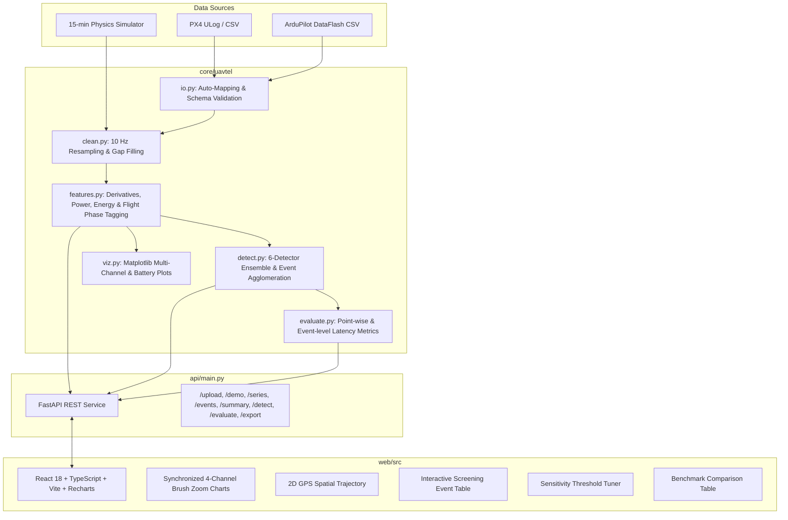
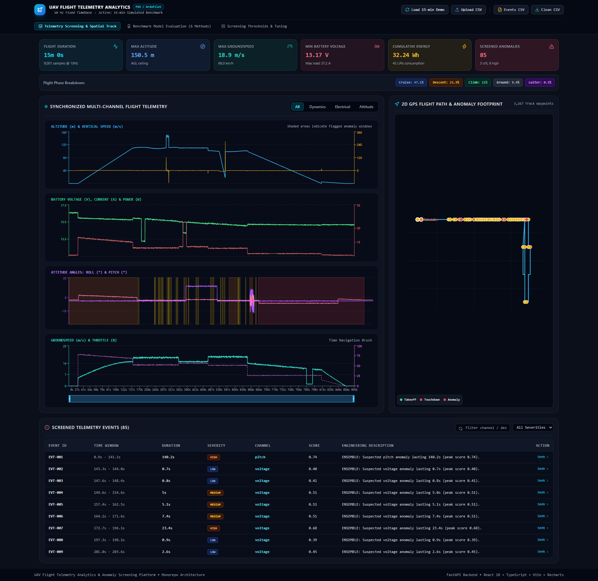
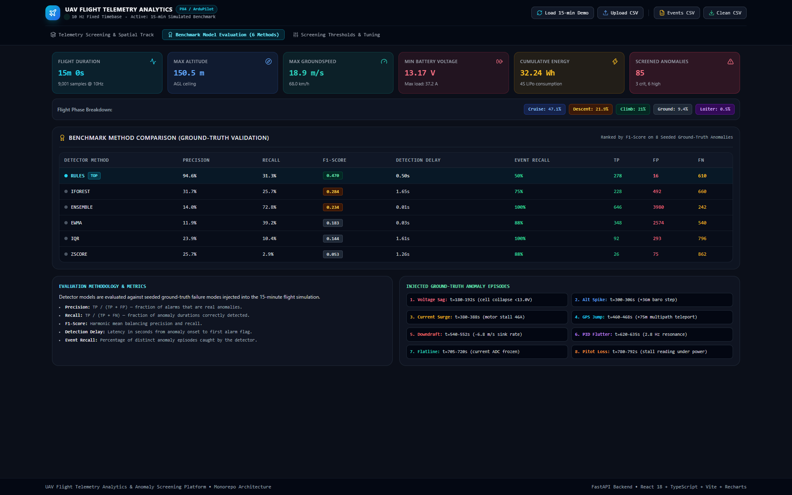

# UAV Flight Telemetry Analytics & Anomaly Screening Platform

[](https://www.python.org/downloads/)
[](https://fastapi.tiangolo.com/)
[](https://react.dev/)
[](https://tailwindcss.com/)
[](https://opensource.org/licenses/MIT)

A high-performance monorepo platform designed for aerospace engineers and UAV flight test operators to ingest, clean, align, and screen multivariate time-series flight telemetry (PX4, ArduPilot, and generic CSV logs). The platform extracts physical flight features, tracks 4S/6S LiPo battery health curves, tags discrete aerodynamic flight phases, and runs multi-baseline anomaly detectors (Z-Score, Tukey IQR, EWMA control charts, domain rules, and multivariate Isolation Forest).

---

## System Architecture



---

## Mathematical Formulations

### 1. Battery Electrodynamics & Internal Resistance (IR) Sag
The battery terminal voltage $V(t)$ accounts for dynamic load sag and progressive state-of-charge (SOC) depletion:
$$SOC(t) = 1.0 - \frac{\int_0^t I(\tau) \, d\tau}{C_{\text{total}}}$$
$$V_{\text{terminal}}(t) = V_{\text{oc}}(SOC(t)) - I(t) \cdot R_{\text{internal}} + \epsilon_{\text{noise}}$$
Where:
- $V_{\text{oc}}(SOC)$ is the open-circuit voltage discharge curve ($16.8\,\text{V} \to 13.0\,\text{V}$).
- $R_{\text{internal}} \approx 0.032\,\Omega$ (32 m$\Omega$) causes instantaneous terminal drop $\Delta V = -R \cdot \Delta I$ during throttle jumps.

### 2. Instantaneous Electrical Power & Cumulative Energy
$$P(t) = V(t) \times I(t) \quad [\text{Watts}]$$
$$E(t) = \frac{1}{3600} \int_0^t P(\tau) \, d\tau \quad [\text{Watt-hours}]$$
Implemented via vectorized trapezoidal integration across uniform 10 Hz intervals.

### 3. Vertical Velocity ($v_z$) & Derivative Smoothing
Calculated with central differences on the 10 Hz time coordinate:
$$v_z(t_k) = \frac{\text{alt}(t_{k+1}) - \text{alt}(t_{k-1})}{t_{k+1} - t_{k-1}}$$
Followed by a 3-point rolling central filter to attenuate high-frequency barometric noise.

### 4. Detection Formulations
1. **Rolling Z-Score**:
   $$z(t) = \frac{|x(t) - \mu_{\text{roll}}(t)|}{\sigma_{\text{roll}}(t) + \epsilon}$$
   Flagged if $z(t) > \tau_z$ (default: $3.2\sigma$).

2. **IQR / Tukey Residuals**:
   $$r(t) = |x(t) - \text{Median}_{\text{roll}}(t)|$$
   Flagged if $r(t) > Q_3(t) + k \cdot \text{IQR}(t)$ (default: $k = 2.5$).

3. **EWMA Control Chart**:
   $$\hat{x}_t = \alpha x_t + (1 - \alpha) \hat{x}_{t-1}, \quad e_t = x_t - \hat{x}_t$$
   Control limits: $\pm L \cdot \sigma_{\text{ewma}}$ (default: $L = 3.0$).

4. **Aerospace Domain Rules**:
   - Critical voltage under load: $V < 13.5\,\text{V}$ when $I > 10\,\text{A}$ or $V < 13.0\,\text{V}$ absolute.
   - Excessive vertical speed: $v_z < -5.0\,\text{m/s}$ (downdraft) or $v_z > 8.0\,\text{m/s}$.
   - GPS coordinate jump: $\Delta d_{\text{step}} > 25\,\text{m}$ at 10 Hz ($>250\,\text{m/s}$ equivalent).
   - Sensor flatline: $\sigma_{\text{roll}}(I) < 10^{-4}$ for $> 2.0\,\text{s}$ while airborne ($alt > 10\,\text{m}$).
   - Speed-throttle mismatch: $throttle > 40\%$ and $groundspeed < 2.5\,\text{m/s}$ while airborne.

5. **Multivariate Isolation Forest**:
   Ensemble of 100 randomized decision trees on robustly scaled feature vectors $[V, I, alt, groundspeed, roll, pitch, v_z, P]$.

6. **Weighted Ensemble Consensus**:
   $$\text{Score}_{\text{ensemble}}(t) = \sum_{m} w_m \cdot S_m(t) \ge \tau_{\text{ensemble}}$$

---

## Monorepo Layout

```
.
├── core/
│   └── uavtel/
│       ├── __init__.py      # Public exports
│       ├── io.py            # Log ingestion (PX4, ArduPilot, generic CSV) & column auto-mapping
│       ├── clean.py         # Unit conversion, deduplication, 10 Hz resampling, gap filling
│       ├── features.py      # Derivatives, rolling stats, power/energy, flight phase classification
│       ├── sim.py           # Seeded 15-min 10 Hz flight physics simulation with 8 ground-truth anomalies
│       ├── detect.py        # 6 baseline detectors, ensemble voting & event agglomeration
│       ├── evaluate.py      # Point-wise & event-wise precision, recall, F1, detection delay
│       └── viz.py           # Matplotlib multi-channel, battery, phase, and GPS trajectory plots
├── tests/
│   ├── conftest.py          # Shared fixtures (simulated flights, messy logs)
│   ├── test_io.py           # Ingestion tests
│   ├── test_clean.py        # Resampling & cleaning tests
│   ├── test_features.py     # Feature extraction tests
│   ├── test_sim.py          # Simulation physics & anomaly tests
│   ├── test_detect.py       # Detector algorithms tests
│   ├── test_evaluate.py     # Benchmark metrics tests
│   ├── test_performance.py  # 100k+ row vectorization benchmark (< 3s)
│   └── test_api.py          # FastAPI endpoint integration tests
├── api/
│   ├── __init__.py
│   └── main.py              # FastAPI application wrapping core package
├── web/                     # React 18 + TypeScript + Vite + Recharts + Tailwind CSS
│   ├── src/
│   │   ├── components/
│   │   │   ├── SummaryCards.tsx
│   │   │   ├── SynchronizedCharts.tsx
│   │   │   ├── GpsTrack.tsx
│   │   │   ├── EventsTable.tsx
│   │   │   ├── DetectorSettings.tsx
│   │   │   └── EvaluationTable.tsx
│   │   ├── services/api.ts
│   │   ├── types/telemetry.ts
│   │   ├── App.tsx
│   │   └── main.tsx
│   ├── package.json
│   └── vite.config.ts
├── data/
│   ├── simulated_15min_flight.csv  # 15-min benchmark dataset (9001 samples)
│   ├── sample_px4_flight_log.csv   # Native PX4 naming format
│   └── sample_ardupilot_log.csv    # Native ArduPilot naming format
├── notebooks/
│   └── uav_telemetry_pipeline.ipynb # End-to-end interactive Jupyter workflow
├── Makefile
├── requirements.txt
├── .gitignore
└── README.md
```

---

## Quickstart & Installation

### Prerequisites
- Python 3.11+
- Node.js 18+ and npm

### 1. Clone & Install Dependencies
```bash
# Install Python core & API dependencies
pip install -r requirements.txt

# Install React frontend dependencies
cd web && npm install && cd ..
```

### 2. Run Test Suite
```bash
# Run all 36 unit and integration tests
python -m pytest tests -v
```

### 3. Launch Backend API (Port 8000)
```bash
python -m uvicorn api.main:app --host 0.0.0.0 --port 8000 --reload
```
API Documentation will be live at: [http://localhost:8000/docs](http://localhost:8000/docs)

### 4. Launch React Dashboard (Port 5173)
```bash
cd web
npm run dev
```
Open [http://localhost:5173](http://localhost:5173) in your browser.

---

## Dashboard Previews

### Live Telemetry Screening & Spatial Track (10 Hz Synchronized)


### Benchmark Model Evaluation


---

| Detector Method | Precision | Recall | F1-Score | Detection Delay | Event Recall | TP | FP | FN |
| :--- | :---: | :---: | :---: | :---: | :---: | :---: | :---: | :---: |
| **RULES** | **94.6%** | 31.3% | **0.470** | 0.50s | 50.0% | 278 | 16 | 610 |
| **ISOLATION FOREST** | 31.7% | 25.7% | 0.284 | 1.65s | 75.0% | 228 | 492 | 660 |
| **ENSEMBLE** | 18.2% | **60.9%** | 0.280 | **0.01s** | **100.0%** | **541** | 2430 | 347 |
| **EWMA** | 11.9% | 39.2% | 0.183 | 0.03s | 87.5% | 348 | 2574 | 540 |
| **IQR / TUKEY** | 23.9% | 10.4% | 0.145 | 1.61s | 100.0% | 92 | 293 | 796 |
| **ROLLING Z-SCORE** | 25.7% | 2.9% | 0.053 | 1.26s | 87.5% | 26 | 75 | 862 |

---

## Roadmap

- [ ] **Bidirectional LSTM Autoencoder Detector**: Train self-supervised temporal reconstruction models on nominal flight logs to detect subtle multi-axis aerodynamic degradation.
- [ ] **MAVLink / ULog Direct Ingestion**: Native binary `.ulg` and `.bin` parser integration without requiring CSV conversion.
- [ ] **Real-Time WebSockets Streaming**: Direct telemetry stream ingest from ground control stations (QGroundControl / Mission Planner).
- [ ] **3D Flight Path Replay**: Three.js / Cesium 3D trajectory playback with attitude orientation gimbal visualization.
